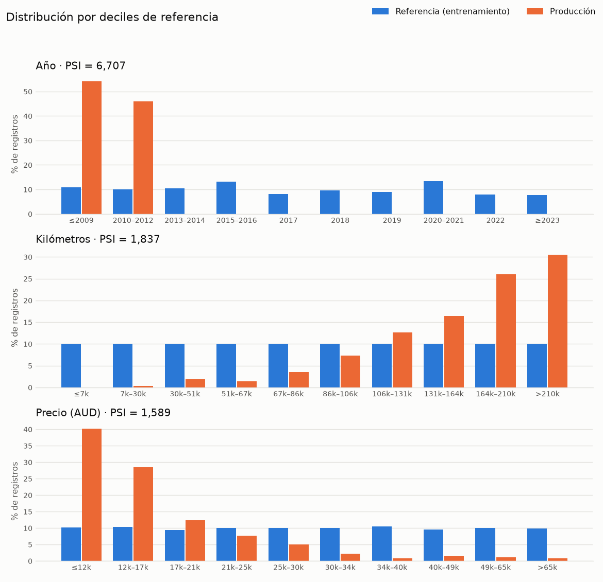

# Fase 4 — Monitoreo

**Proyecto:** Predicción de precios de vehículos en Australia  
**Asignatura:** Modelos y Simulación de Sistemas I  
**Repositorio:** [PredictiveModel](https://github.com/yizhubrorh-del/PredictiveModel)

## 1. Objetivo y alcance

Esta fase amplía la API de la Fase 3 con mecanismos básicos para supervisar el modelo:

| Requisito | Implementación |
|---|---|
| Registrar predicciones | Cada solicitud y cada predicción se guardan en SQLite. `POST /feedback` añade el precio real de una predicción |
| Mostrar métricas básicas | `GET /metrics` y el script `monitor.py reporte`: operación, predicciones, error real y deriva (PSI) |
| Mantener versiones del modelo | `GET /models` y `PUT /models/active` para promover o revertir, con historial persistente. Las versiones nunca se sobrescriben |
| Política de reentrenamiento | [POLITICA_REENTRENAMIENTO.md](POLITICA_REENTRENAMIENTO.md), aplicada en código por `monitoreo/politica.py` |

**Sin código duplicado:** la Fase 4 importa la API de la Fase 3 y, a través de ella, `train.py`, `src/` y los modelos de la Fase 2. `monitoreo/config.py` agrega `fase-3` al `sys.path`. La API de la Fase 3 recibió dos *hooks* opcionales en `create_app`, que no cambian su comportamiento cuando no se usan (sus 30 pruebas siguen pasando):

- `active_version`: la versión que usa `/predict`.
- `on_prediction`: se llama tras cada predicción y devuelve sus identificadores.

## 2. Entregables

| Entregable | Archivo |
|---|---|
| Carpeta `fase-4` | esta carpeta |
| Script de monitoreo | [`monitor.py`](monitor.py): comandos `reporte`, `perfil`, `comparar` y `exportar` |
| Reporte | [`reportes/escenario_normal/`](reportes/escenario_normal/reporte_monitoreo.md) y [`reportes/escenario_deriva/`](reportes/escenario_deriva/reporte_monitoreo.md) |
| Política de reentrenamiento | [`POLITICA_REENTRENAMIENTO.md`](POLITICA_REENTRENAMIENTO.md) |

## 3. Estructura

```text
fase-4/
├── api_monitoreo.py            # API de la Fase 3 + registro, /feedback, /metrics, /models
├── monitor.py                  # script de monitoreo
├── simular_trafico.py          # genera tráfico de prueba contra la API
├── monitoreo/
│   ├── config.py               # rutas y acceso a fase-3 / fase-2
│   ├── store.py                # registro SQLite (solicitudes, predicciones, eventos)
│   ├── metricas.py             # métricas y PSI
│   └── politica.py             # reglas y umbrales de reentrenamiento
├── referencia/
│   └── perfil_referencia.json  # distribución del dataset de entrenamiento
├── reportes/                   # reportes generados (Markdown, JSON, figura)
├── tests/test_monitoreo.py     # 30 pruebas pytest
├── POLITICA_REENTRENAMIENTO.md
├── requirements.txt
├── Dockerfile
└── Dockerfile.dockerignore
```

`logs/` contiene las bases SQLite locales y está excluida en `.gitignore`.

## 4. Instalación y ejecución

PowerShell, desde la raíz del repositorio:

```powershell
python -m venv .venv
.\.venv\Scripts\Activate.ps1
python -m pip install -r fase-4/requirements.txt
cd fase-4
uvicorn api_monitoreo:create_app --factory --port 8000
```

`requirements.txt` incluye las dependencias de las Fases 2 y 3 y añade `matplotlib==3.11.2` para la figura del reporte. La documentación interactiva está en <http://localhost:8000/docs>.

| Variable | Valor por defecto | Uso |
|---|---|---|
| `MONITOR_DB` | `fase-4/logs/monitoreo.db` | Base SQLite del registro |
| `PERFIL_REFERENCIA` | `fase-4/referencia/perfil_referencia.json` | Referencia para medir la deriva |
| `MODELS_DIR`, `DATA_PATH`, `DEFAULT_MODEL_VERSION` | como en la Fase 3 | `DEFAULT_MODEL_VERSION` solo se usa si nunca se activó otra versión |

## 5. Endpoints

Se mantienen `/health`, `/predict` y `/train` de la Fase 3. Se agregan:

| Método | Ruta | Función |
|---|---|---|
| `POST` | `/feedback` | Registra el precio real de una predicción: `{"id_prediccion": "...", "precio_real": 21000}`. Responde 404 si no existe y 409 si ya tiene precio |
| `GET` | `/metrics[?horas=24]` | Métricas de la ventana indicada y decisión de la política |
| `GET` | `/models` | Versiones con sus métricas de prueba, versión activa e historial de activaciones |
| `PUT` | `/models/active` | `{"version": "v2"}`: promueve o revierte. Responde 404 si la versión no existe |

`/predict` ahora devuelve también `ids_prediccion`, uno por vehículo, para poder enviar después el precio real:

```json
{ "version": "v1", "moneda": "AUD", "n": 1, "predicciones": [61107.88],
  "ids_prediccion": ["29f452c717f444d69f74468c1368abe5"] }
```

**Qué se registra**

- `solicitudes`: fecha, método, ruta, código HTTP y latencia de cada petición (excepto `/docs` y `/openapi.json`).
- `predicciones`: id, fecha, lote, versión, precio predicho, `Brand`/`Year`/`Kilometres`, la entrada completa en JSON y, si llega, el precio real.
- `eventos_modelo`: activaciones de versiones, con la versión anterior.

Si falla el registro, la predicción se responde igualmente (sin `ids_prediccion`) y el error queda en el log.

## 6. Script de monitoreo

Desde `fase-4`:

```powershell
python monitor.py reporte --salida reportes/2026-11-21            # todo el registro
python monitor.py reporte --horas 168 --salida reportes/semana    # últimos 7 días
python monitor.py exportar --salida datos_produccion.csv          # vehículos con precio real
python monitor.py comparar --data evaluacion.csv --versiones v1 v2 --activa v1
python monitor.py perfil                                          # regenera la referencia
```

`reporte` genera `reporte_monitoreo.md`, `resumen.json` (el mismo contenido que `/metrics`) y `deriva.png`. Termina con **código 2** si la decisión es REENTRENAR, para que una tarea programada pueda detectarlo.

## 7. Reportes de ejemplo

Para producir los reportes entregados, `simular_trafico.py` envía a la API vehículos reales de la **partición de prueba de `v1`**: datos que el modelo no vio, reproducidos con la misma semilla que `train.py`. Devuelve el precio real del 70 % de ellos e incluye 5 solicitudes inválidas.

```powershell
python simular_trafico.py --escenario normal --db logs/normal.db
python monitor.py reporte --db logs/normal.db --salida reportes/escenario_normal
python simular_trafico.py --escenario deriva --db logs/deriva.db
python monitor.py reporte --db logs/deriva.db --salida reportes/escenario_deriva
```

Con `--url http://localhost:8000`, el simulador envía el tráfico a una API en ejecución en lugar de a una instancia en proceso.

| | Escenario normal | Escenario deriva (solo vehículos ≤ 2012) |
|---|---:|---:|
| Vehículos predichos · con precio real | 800 · 559 | 708 · 492 |
| PSI Year · Kilometres · precio predicho | 0,014 · 0,005 · 0,018 | **6,707 · 1,837 · 1,589** |
| MAE producción (prueba: 4.929,86 AUD) | 4.858,91 (0,99×) | 3.423,71 (0,69×) |
| MAPE producción (prueba: 13,2 %) | 13,9 % (1,06×) | **20,4 % (1,55×)** |
| Latencia `/predict` p95 | 112 ms | 93 ms |
| **Decisión** | 🟢 **OK** | 🔴 **REENTRENAR** (R1 y R2) |

**Lectura de los resultados**

- En el escenario normal, el MAE en producción reproduce el de prueba (0,99×). Esto confirma que el registro, el *feedback* y el cálculo del error son coherentes con la Fase 2.
- En el escenario de deriva, el **MAE baja** porque los autos viejos son baratos y su error en dólares es menor, pero el **MAPE sube un 55 %**. Si la política vigilara solo el MAE, no detectaría que el modelo funciona peor con esa población. Por eso R2 vigila ambas métricas.



## 8. Pruebas automatizadas

Desde `fase-4`:

```powershell
python -m pytest -v
```

Las **30 pruebas** de `tests/test_monitoreo.py` usan datos sintéticos, modelos rápidos y bases temporales. Reutilizan los ayudantes de las pruebas de la Fase 2 y cubren:

1. Registro de predicciones con ids únicos, y registro de todas las solicitudes, incluidas las fallidas (422 y 404).
2. Una falla del registro no impide responder la predicción.
3. `/feedback`: caso correcto, predicción inexistente (404), duplicado (409) y entradas inválidas (422).
4. `/metrics`: contenido, ventana de horas y parámetro inválido.
5. `/models` y `PUT /models/active`: promoción, reversión, persistencia tras reiniciar y versión inexistente o inválida.
6. PSI: 0 con distribuciones iguales y > 0,25 con un desplazamiento fuerte.
7. Política: los 11 casos de las reglas R1–R4, muestras insuficientes y ausencia de perfil.
8. `monitor.py`: generación del reporte, código de salida 2, base inexistente, `comparar` y `exportar`.

**Evidencia en Windows:** 30 passed (Fase 4), 30 passed (Fase 3) y 7 passed (Fase 2), con Python 3.14.7.

## 9. Docker

La imagen se construye **desde la raíz del repositorio**, porque reutiliza `fase-2` y `fase-3`. El registro se guarda en un volumen para que sobreviva al contenedor.

```powershell
$root = (Get-Location).Path
docker build -f fase-4/Dockerfile -t predictivemodel-fase4:1.0 .
docker run --rm -p 8000:8000 `
  --mount "type=bind,source=$root\data,target=/app/data,readonly" `
  --mount "type=bind,source=$root\fase-2\models,target=/app/fase-2/models" `
  --mount "type=bind,source=$root\fase-4\logs,target=/app/fase-4/logs" `
  predictivemodel-fase4:1.0
```

Reporte desde el contenedor en ejecución:

```powershell
docker exec <contenedor> python monitor.py reporte --salida /app/fase-4/logs/reporte
```

**Estado de verificación:** pendiente de ejecutar en Docker, porque Docker Desktop no estaba iniciado durante el desarrollo. La API se verificó con uvicorn en local: simulación por HTTP, `/metrics`, cambio de versión y `/health`.

## 10. Lista de verificación

- [x] Registro de solicitudes y predicciones en SQLite.
- [x] Precio real por `/feedback` y error en producción por versión.
- [x] Métricas por API (`/metrics`) y por script (`monitor.py reporte`).
- [x] Deriva de datos con PSI frente a un perfil de referencia.
- [x] Versiones: listado, promoción, reversión e historial persistente.
- [x] Política de reentrenamiento documentada, implementada y con umbrales calibrados.
- [x] Reportes de ejemplo (escenario normal y escenario de deriva).
- [x] 30 pruebas pytest aprobadas; Fases 2 y 3 sin regresiones.
- [ ] Construcción y ejecución verificadas en Docker.
- [ ] Pull Request a `develop` revisado por otro integrante.
