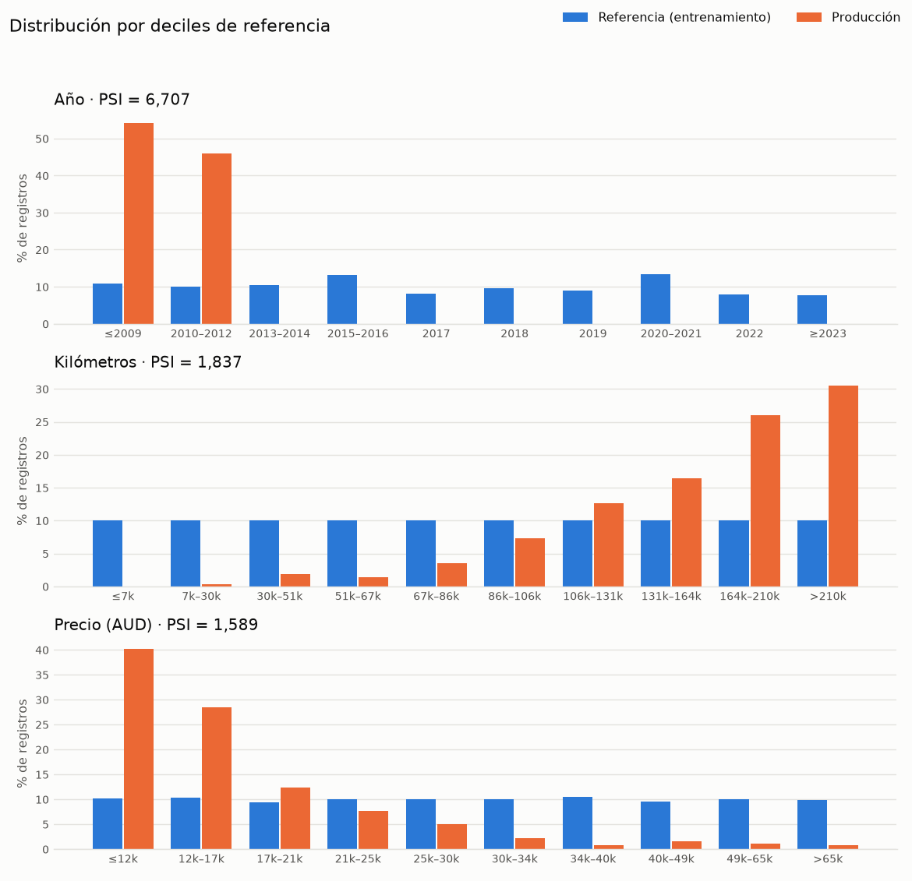

# Reporte de monitoreo del modelo

- **Generado (UTC):** 2026-11-21T19:46:59+00:00
- **Ventana:** 2026-11-21T19:46:39.987+00:00 → 2026-11-21T19:46:56.980+00:00
- **Modelo activo:** `v1`
- **Decisión de la política:** **🔴 REENTRENAR**

## 1. Política de reentrenamiento

| Nivel | Regla | Motivo |
|---|---|---|
| 🔴 REENTRENAR | R1-deriva | PSI de Year = 6,707 > 0,25. |
| 🔴 REENTRENAR | R1-deriva | PSI de Kilometres = 1,837 > 0,25. |
| 🔴 REENTRENAR | R1-deriva | PSI de precio_predicho = 1,589 > 0,25. |
| 🔴 REENTRENAR | R2-rendimiento | MAPE de v1 en producción = 20,4 %, 1,55× el de prueba (13,2 %). |
| 🟢 OK | R2-rendimiento | MAE de v1 en producción = 3.424 AUD, 0,69× el de prueba (4.930 AUD). |
| 🟢 OK | R3-antiguedad | El modelo v1 tiene 24 días (máximo 180). |

Umbrales y procedimiento: [POLITICA_REENTRENAMIENTO.md](../../POLITICA_REENTRENAMIENTO.md).

## 2. Operación del servicio

| Métrica | Valor |
|---|---|
| Solicitudes | 528 |
| Por ruta | `/feedback`: 492, `/predict`: 34, `/health`: 1, `/metrics`: 1 |
| Por código HTTP | 200: 31, 201: 492, 404: 1, 422: 4 |
| Errores de cliente (4xx) | 0,9 % |
| Errores de servidor (5xx) | 0,0 % |
| Latencia /predict p50 · p95 · máx (ms) | 74,8 · 93,0 · 125,1 |

## 3. Predicciones registradas

| Métrica | Valor |
|---|---|
| Vehículos predichos | 708 |
| Por versión | `v1`: 708 |
| Precio medio (AUD) | 16.331,66 |
| P05 · mediana · P95 (AUD) | 6.831 · 13.565 · 31.933 |

## 4. Rendimiento con precio real

Predicciones con precio real recibido por `POST /feedback`: **492** (69 % del total).

| Versión | n | MAE producción (AUD) | MAE prueba (AUD) | Razón MAE | MAPE producción | MAPE prueba | Razón MAPE |
|---|---|---|---|---|---|---|---|
| `v1` | 492 | 3.423,71 | 4.929,86 | 0,69× | 20,4 % | 13,2 % | 1,55× |

Razón = métrica en producción / métrica en la partición de prueba. El MAE (AUD) depende del precio de los vehículos; el MAPE es relativo.

## 5. Deriva de datos

| Variable | n | PSI | Media referencia | Media producción | Faltantes |
|---|---|---|---|---|---|
| Year | 708 | 6,707 | 2.016,2 | 2.008,2 | 0,0 % |
| Kilometres | 706 | 1,837 | 100.290,7 | 182.274,0 | 0,3 % |
| precio_predicho | 708 | 1,589 | 37.305,6 | 16.331,7 | 0,0 % |

PSI < 0,10 estable · 0,10–0,25 cambio moderado · > 0,25 cambio fuerte.
Marcas no vistas en entrenamiento: 0,0 %

## 6. Versiones del modelo

| Versión | Activa | Creada (UTC) | Semilla | MAE prueba | R² prueba | Commit |
|---|---|---|---|---|---|---|
| `v1` | ✅ | 2026-10-28T23:52:13 | 42 | 4.929,86 | 0,892 | `1e350fe` |
| `v2` |  | 2026-10-28T23:55:04 | 43 | 4.835,43 | 0,883 | `1e350fe` |
