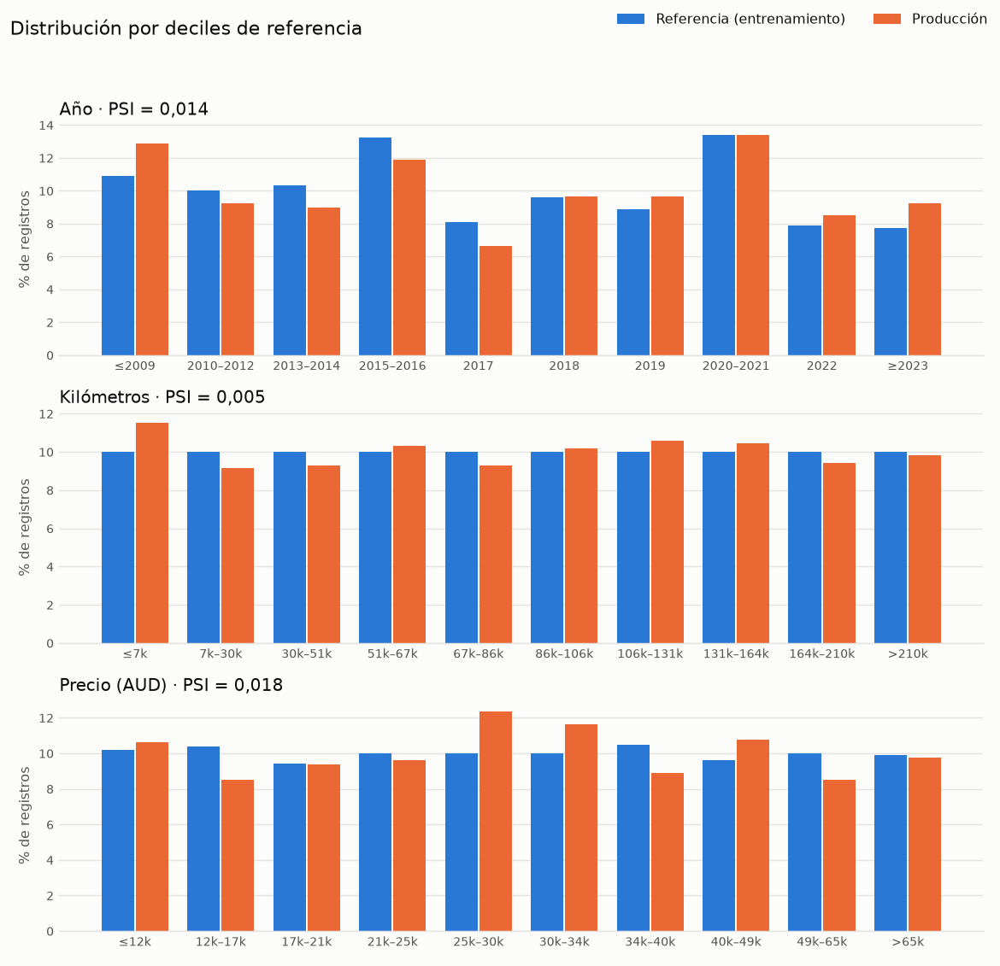

# Reporte de monitoreo del modelo

- **Generado (UTC):** 2026-11-21T19:46:32+00:00
- **Ventana:** 2026-11-21T19:46:11.178+00:00 → 2026-11-21T19:46:30.067+00:00
- **Modelo activo:** `v1`
- **Decisión de la política:** **🟢 OK**

## 1. Política de reentrenamiento

| Nivel | Regla | Motivo |
|---|---|---|
| 🟢 OK | R1-deriva | Distribuciones estables: PSI máximo 0,018 (precio_predicho) ≤ 0,10. |
| 🟢 OK | R2-rendimiento | MAE de v1 en producción = 4.859 AUD, 0,99× el de prueba (4.930 AUD). |
| 🟢 OK | R2-rendimiento | MAPE de v1 en producción = 13,9 %, 1,06× el de prueba (13,2 %). |
| 🟢 OK | R3-antiguedad | El modelo v1 tiene 24 días (máximo 180). |

Umbrales y procedimiento: [POLITICA_REENTRENAMIENTO.md](../../POLITICA_REENTRENAMIENTO.md).

## 2. Operación del servicio

| Métrica | Valor |
|---|---|
| Solicitudes | 598 |
| Por ruta | `/feedback`: 559, `/predict`: 37, `/health`: 1, `/metrics`: 1 |
| Por código HTTP | 200: 34, 201: 559, 404: 1, 422: 4 |
| Errores de cliente (4xx) | 0,8 % |
| Errores de servidor (5xx) | 0,0 % |
| Latencia /predict p50 · p95 · máx (ms) | 77,4 · 112,4 · 170,6 |

## 3. Predicciones registradas

| Métrica | Valor |
|---|---|
| Vehículos predichos | 800 |
| Por versión | `v1`: 800 |
| Precio medio (AUD) | 36.570,15 |
| P05 · mediana · P95 (AUD) | 9.477 · 29.244 · 80.874 |

## 4. Rendimiento con precio real

Predicciones con precio real recibido por `POST /feedback`: **559** (70 % del total).

| Versión | n | MAE producción (AUD) | MAE prueba (AUD) | Razón MAE | MAPE producción | MAPE prueba | Razón MAPE |
|---|---|---|---|---|---|---|---|
| `v1` | 559 | 4.858,91 | 4.929,86 | 0,99× | 13,9 % | 13,2 % | 1,06× |

Razón = métrica en producción / métrica en la partición de prueba. El MAE (AUD) depende del precio de los vehículos; el MAPE es relativo.

## 5. Deriva de datos

| Variable | n | PSI | Media referencia | Media producción | Faltantes |
|---|---|---|---|---|---|
| Year | 800 | 0,014 | 2.016,2 | 2.016,2 | 0,0 % |
| Kilometres | 765 | 0,005 | 100.290,7 | 99.996,0 | 4,4 % |
| precio_predicho | 800 | 0,018 | 37.305,6 | 36.570,2 | 0,0 % |

PSI < 0,10 estable · 0,10–0,25 cambio moderado · > 0,25 cambio fuerte.
Marcas no vistas en entrenamiento: 0,0 %

## 6. Versiones del modelo

| Versión | Activa | Creada (UTC) | Semilla | MAE prueba | R² prueba | Commit |
|---|---|---|---|---|---|---|
| `v1` | ✅ | 2026-10-28T23:52:13 | 42 | 4.929,86 | 0,892 | `1e350fe` |
| `v2` |  | 2026-10-28T23:55:04 | 43 | 4.835,43 | 0,883 | `1e350fe` |
